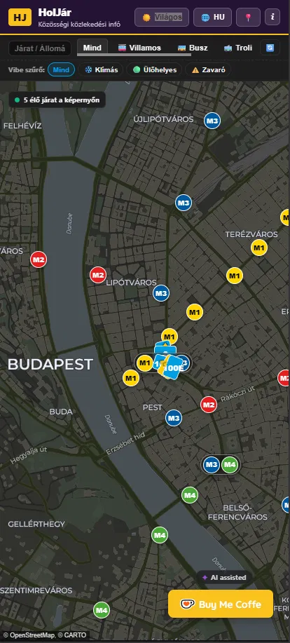
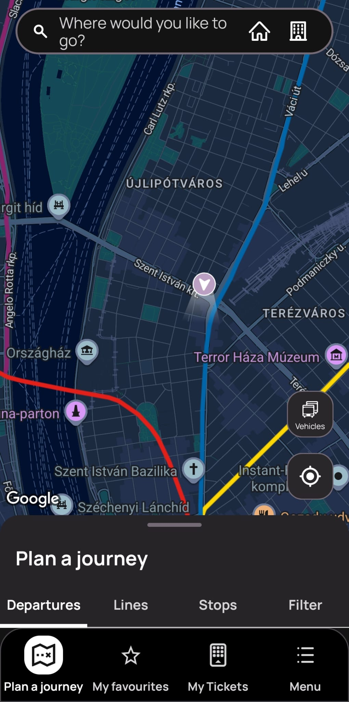
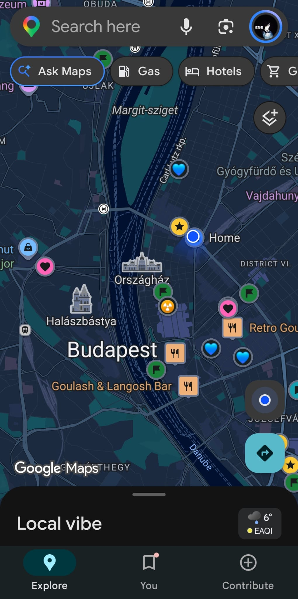
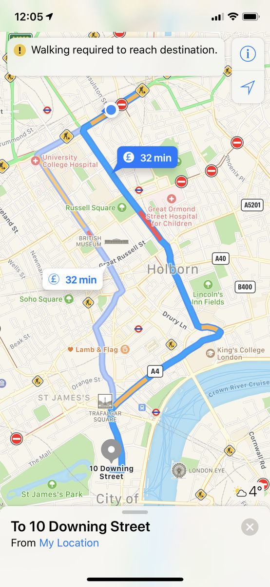

# References

My goal: an app that old people and people with no tech knowledge can use easily.

## Competitors (3)

### 1. HolJár, old version (my own)

Link: https://oldhol.netlify.app/
- **Take:** Vibe filter idea (AC, seats, annoying). Users can see the vehicle condition on the map.
- **Avoid:** Too many things at the top (theme, language, location, info, tabs, filters). Small text, many colored markers, and a big yellow button that covers the map.

### 2. Budapest GO

Link: https://bkk.hu/en/tickets-and-passes/budapestgo/
- **Take:** Bottom navigation with text under each icon, and shortcuts for Home and Work next to the search bar.
- **Avoid:** Many tabs and options at once (Departures, Lines, Stops, Filter). Not easy enough for people with no tech knowledge.

### 3. Google Maps (public transport)

Link: https://www.google.com/maps
- **Take:** One search bar at the top, and the rest is simple. Most people already know it.
- **Avoid:** Too many options for my small app (layers, Ask Maps, Contribute). Not made for vehicle comfort.

Only Google Maps has a similar idea (crowd reports), but it is hidden inside a big app and is not easy to use for this task. I did not find another app focused on vehicle comfort (AC, crowding, cleanliness).

## Patterns (3)

### 4. Minimal map controls: search bar on top, zoom buttons bottom right (Google Maps)
- **Take:** Only one search bar and two big zoom buttons on the map. Everything else is hidden, so the map stays clean.
- **Avoid:** Extra buttons on the map (layers, Ask Maps, Contribute). They make it busy.

### 5. Side menu opened with the three lines icon (Google Maps)
- **Take:** One side menu for all other things (settings, language, info). The main screen stays simple.
- **Avoid:** Hiding important actions in the menu. Old people may not find them, so the main task must stay on the main screen.

### 6. First-time tutorial (onboarding)
- **Take:** A short guide when the user opens the app for the first time, so people with no tech knowledge know what to do.
- **Avoid:** A long tutorial. It should be skippable and short.

## Visuals (3)

### 7. Budapest GO (look and colors)

- **Take:** Dark map with a rounded card at the bottom and clear icons. It looks calm and modern.
- **Avoid:** Small gray text on the tabs. It is hard to read, especially for old people.

### 8. Google Maps (clarity)

- **Take:** Big search bar, big icons and strong contrast between text and background. Easy to read at a glance.
- **Avoid:** Cut-off buttons on the right edge and too many colored markers on the map.

### 9. Apple Maps (route screen)

- **Take:** Thick blue route line and big time labels (32 min). A large title and one clear close button in the bottom card.
- **Avoid:** Many small icons on the map (roadworks, no entry signs) and small gray text.
